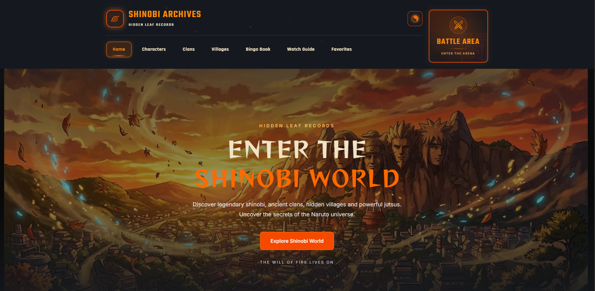
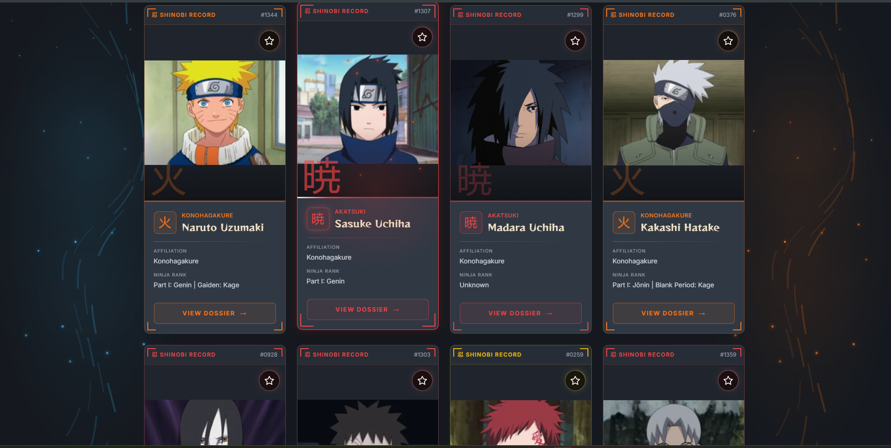
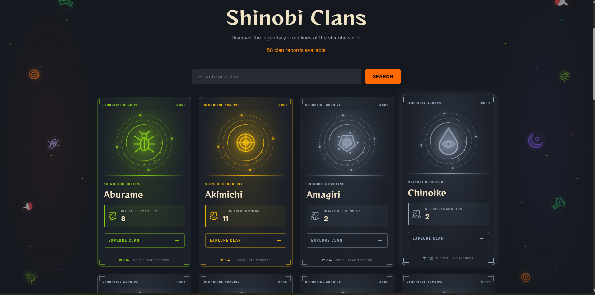
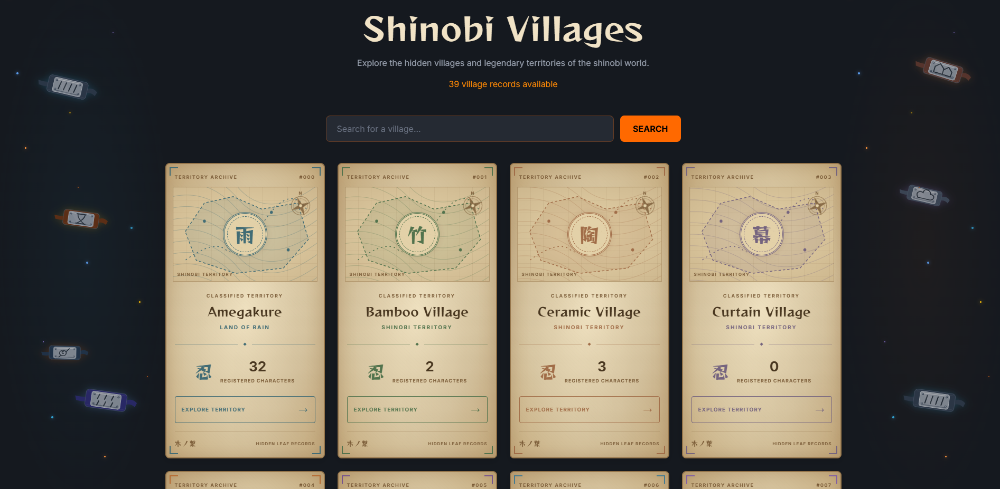
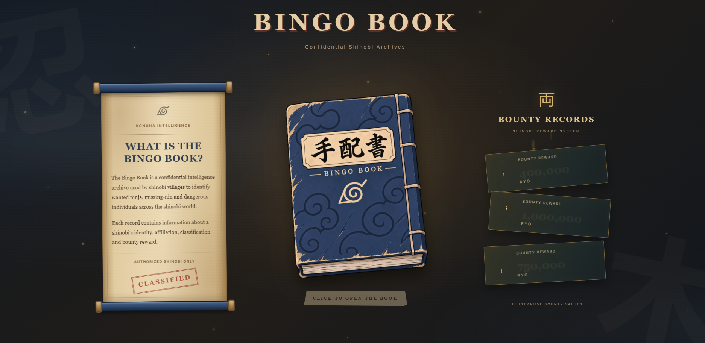
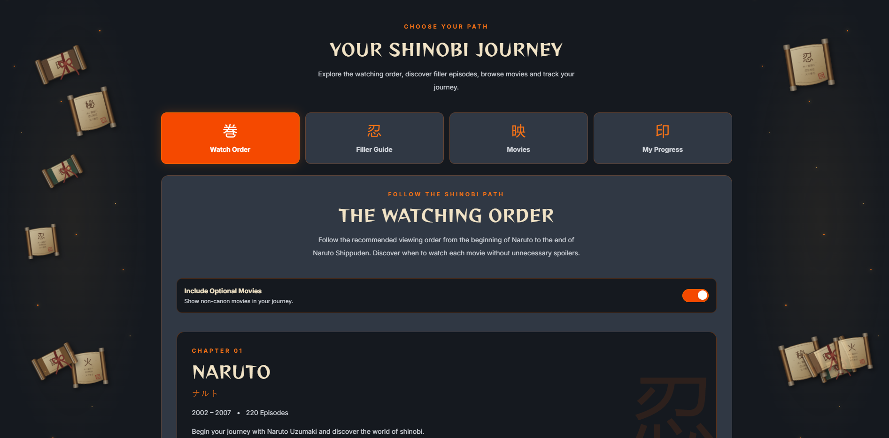
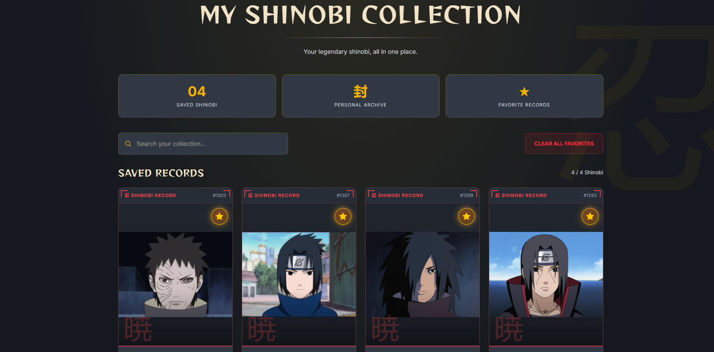
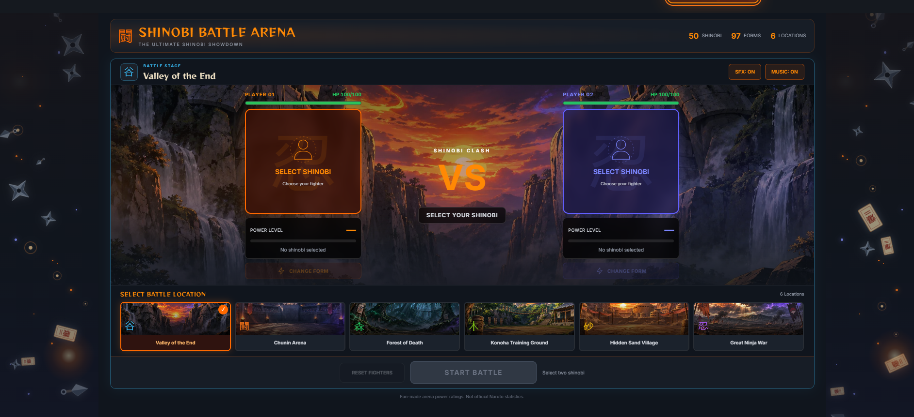

# 🍥 Naruto Shinobi Archives



> Enter the Shinobi World — The Will of Fire Lives On.

## 📖 About the Project

Naruto Shinobi Archives is an interactive, responsive, and API-driven wiki dedicated to the Naruto and Naruto Shippuden universe.

The project was developed as a midterm project for the SE3355 course at Yaşar University. Its purpose is to demonstrate frontend development with React, Tailwind CSS, and JSON-based data retrieval from public web APIs.

The application combines a detailed shinobi encyclopedia with interactive features, custom animations, a watching guide, and a battle simulation system.

## ✨ Main Features

- API-driven character, clan, and village archives
- Dynamic character, clan, and village detail pages
- Search, filtering, and pagination
- Naruto and Naruto Shippuden character filtering
- Random Shinobi Summoning
- Favorite character collection
- Interactive 3D Bingo Book
- Anime and movie watching guide
- Filler episode filtering
- Personal watch progress tracking
- Interactive Shinobi Battle Arena
- Light and Dark Mode
- Responsive navigation and layouts
- Custom Naruto-themed animations
- Sound effects and background music
- Loading, error, and empty-state interfaces
- Local storage integration

## 🖼️ Application Screenshots

### 1. Home Page

Explore the Naruto universe through a cinematic Konoha-themed homepage with animated elements and interactive navigation.


### 2. Shinobi Characters

Browse character records, search for specific shinobi, explore detailed information, and save your favorite characters.



### 3. Shinobi Clans

Discover 58 clan records with themed cards, clan symbols, animated chakra effects, and registered members.



### 4. Shinobi Villages

Explore 39 village records through parchment-style territory cards, village information, and animated ninja headbands.



### 5. Bingo Book

An interactive intelligence archive inspired by the Bingo Book from the Naruto universe.

- 40 shinobi records
- Interactive page-turning animations
- Confidential character dossiers
- Character classifications
- Illustrative bounty rewards
- Page-turning sound effects



### 6. Watch Guide

A comprehensive watching guide for Naruto and Naruto Shippuden.

- 720 anime episodes
- 2 anime series
- 10 movies
- Canon and filler classifications
- Recommended watching order
- Movie information
- Personal watch progress tracking



### 7. Favorites

Create a personal shinobi collection by saving your favorite characters.

Favorites are stored locally and remain available after refreshing the application.



### 8. Shinobi Battle Arena

An interactive, fan-made battle simulation system.

- 50 shinobi with defined battle statistics
- 97 character forms
- 6 battle locations
- Character and transformation selection
- Dynamic health bars
- Power level calculations
- Animated battle stages
- Jutsu-inspired visual effects
- Battle music and sound effects
- Victory and draw results

Battle statistics and power levels are fan-made and do not represent official Naruto power rankings.



## 🛠️ Technologies Used

| Technology | Purpose |
|---|---|
| React | Component-based frontend development |
| JavaScript | Application logic and interactivity |
| Tailwind CSS | Styling and responsive design |
| Vite | Development server and production builds |
| React Router | Client-side routing |
| React PageFlip | Interactive book animations |
| SVG | Custom symbols and visual effects |
| Web Audio API | Battle sound effects |
| Local Storage | Favorites, preferences, and watch progress |
| Git | Version control |
| GitHub | Source code hosting |

## 🌐 Public APIs

### Dattebayo API

Used to retrieve Naruto universe data, including:

- Characters
- Clans
- Villages
- Character images
- Personal information
- Ninja ranks
- Jutsu information
- Affiliations

API: https://dattebayo-api.onrender.com

### Kitsu API

Used to retrieve anime movie information, including:

- Movie posters
- Descriptions
- Ratings
- Release dates
- Movie durations

API: https://kitsu.io/api/edge

## ⚛️ React Concepts

The project demonstrates the following React concepts:

- Functional components
- Reusable components
- Props
- useState
- useEffect
- useRef
- Context API
- Custom hooks
- Conditional rendering
- Dynamic list rendering
- Event handling
- Client-side routing
- Dynamic route parameters
- Asynchronous API requests
- State management
- Lazy loading

## 📂 Project Structure

```text
Naruto-Shinobi-Archives/
├── docs/
│   └── screenshots/
├── public/
│   ├── images/
│   └── sounds/
├── src/
│   ├── components/
│   ├── context/
│   ├── data/
│   ├── hooks/
│   ├── pages/
│   ├── services/
│   ├── App.jsx
│   ├── index.css
│   └── main.jsx
├── index.html
├── package.json
├── vite.config.js
└── README.md
```

## 🚀 Installation and Setup

### Clone the repository

```bash
git clone https://github.com/beratbicen161/Naruto-Shinobi-Archives.git
```

### Navigate to the project directory

```bash
cd Naruto-Shinobi-Archives
```

### Install dependencies

```bash
npm install
```

### Start the development server

```bash
npm run dev
```

### Create a production build

```bash
npm run build
```

### Preview the production build

```bash
npm run preview
```

## ⚡ Performance Optimization

The application includes several performance improvements:

- WebP image optimization
- Optimized logo assets
- Lazy loading of images
- Route-based code splitting
- Image loading prioritization
- Optimized font loading
- API response caching
- Reduced-motion support

Desktop Lighthouse performance scores of 95 or higher were achieved on tested pages, including Home and Watch Guide, during local production testing.

Performance results may vary depending on the device, network connection, and external API availability.

## 📱 Responsive Design

The application supports:

- Desktop computers
- Tablets
- Mobile devices

Layouts, navigation, cards, and interactive components adapt to different screen sizes.

## 👨‍💻 Developer

**Berat Biçen**

- University: Yaşar University
- Department: Software Engineering
- Course: SE3355
- Project: Midterm Project
- Academic Year: 2026–2027

GitHub: https://github.com/beratbicen161

## ⚠️ Disclaimer

This is an unofficial, non-commercial educational fan project.

Naruto, Naruto Shippuden, their characters, and related intellectual property belong to their respective copyright holders.

Character information and external images are provided by third-party APIs. Some images or records may be unavailable due to external API limitations.

Battle statistics, illustrative bounty values, and selected decorative symbols are fan-made.

---

<p align="center">
  <strong>忍 — THE WILL OF FIRE LIVES ON — 忍</strong>
</p>
